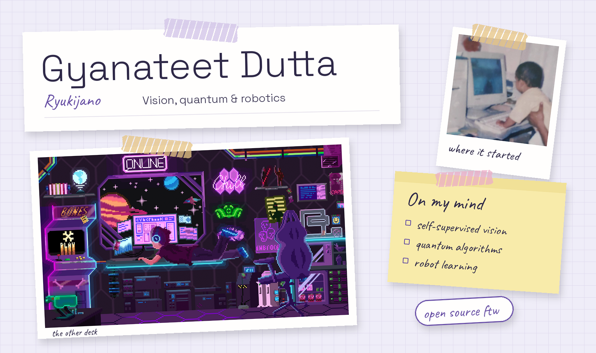
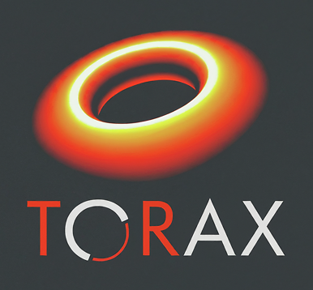
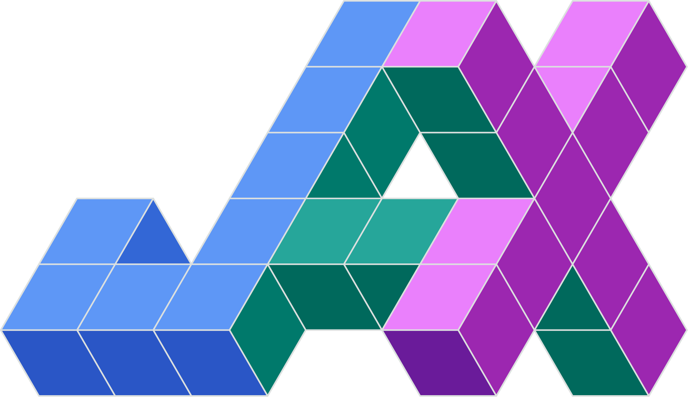
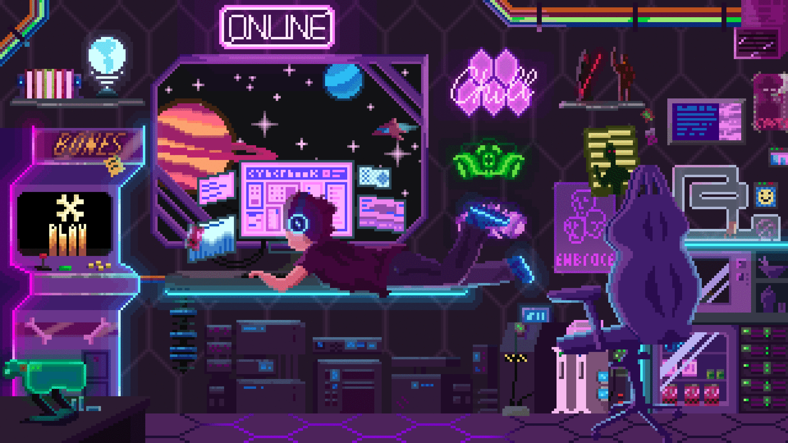

<picture>
  <source media="(max-width: 600px)" srcset="./assets/pinboard-mobile.png">
  
</picture>

**Researcher at the University of Leeds. Qiskit Advocate.**

I work on self-supervised vision for medical imaging, perception and learning for robots, and quantum-classical algorithms for scientific problems.

  
  
  
  
  

## What I work on

- **Vision:** self-supervised learning for surgical video and medical imaging; NeRFs and 3D Gaussian splatting.
- **Robotics:** vision-language-action policies, robot perception and manipulation.
- **Quantum & scientific computing:** quantum algorithms, error correction, hardware co-design and machine learning for science.

## Selected work

| Work | What it's about |
| :--- | :--- |
| ISBI 2026 paper | Self-supervised Transformers for surgical phase recognition. |
| [Gemma-GR00T](https://github.com/Ryukijano/Gemma-Grook) | A vision-language-action policy using SigLIP, Gemma 3 and ScaleDP. |
| Bradford Quantum Hackathon 2025 — winner | A quantum-classical hybrid system for genomic sequence prediction. |
| City of London Mayor Quantum Hackathon — finalist | Applications of IBM quantum computing. |

## Sticker drawer

  

<strong>Quantum & scientific computing</strong>

  
  
  
  
  
  
  
  

  

<strong>Machine learning & vision</strong>

  

  

  
  
  
  
  

<strong>Tools, platforms & simulation</strong>

  

  
  
  
  
  
  
  
  
  
  

<strong>The pixel desk & Hugging Face hugs</strong>

  

  

<strong>Contribution streak & snake</strong>

  

  

[GitHub activity](https://github.com/Ryukijano?tab=overview) · [Snake generator](https://github.com/Ryukijano/Ryukijano/actions/workflows/snake.yml)

---

Have an interesting research idea or an open-source project? [Get in touch](mailto:gyanateet@gmail.com).
